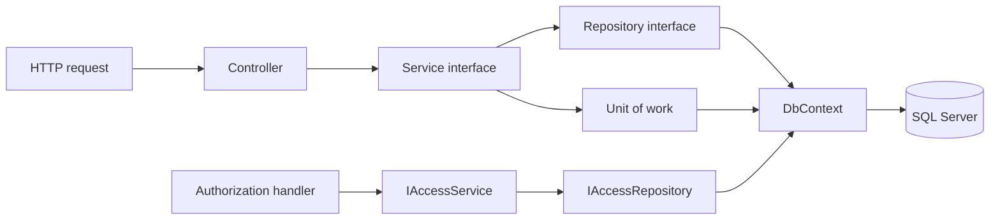

# Quy chuẩn kiến trúc và phong cách code OjitexSystem

Phiên bản 1.0 — áp dụng từ 15/10/2026.

Tài liệu này là chuẩn cho code mới và phần code được sửa trong dự án. [AGENTS.md](../AGENTS.md) yêu cầu coding agent đọc và tuân theo trước mỗi công việc. [architecture.md](architecture.md) giữ mô tả hệ thống thực tế và lịch sử refactor; số liệu kiểm thử trong báo cáo không thay thế việc kiểm tra thay đổi mới.

## 1. Nguyên tắc chung

- Tổ chức code theo phạm vi tính năng đã triển khai và trách nhiệm thực sự của từng lớp.
- Chọn cách triển khai nhỏ nhất đáp ứng nghiệp vụ, có thể đọc và kiểm tra độc lập. Abstraction mới phải có mục đích cụ thể; không tạo generic repository, base service/controller hoặc framework nội bộ chỉ để giảm vài dòng lặp.
- Quy tắc trong tài liệu áp dụng cho code mới/phần đang sửa. Không đổi hàng loạt file không liên quan chỉ để đồng nhất style. Khi mẫu code cũ vi phạm ranh giới đã quy định, dùng cách đúng layer thay vì sao chép lỗi đó.
- Giữ hành vi, API contract và giao diện bên ngoài ngoài phạm vi yêu cầu. Khi hợp đồng cần thay đổi, sửa đồng bộ bên gọi, test và tài liệu.
- Không suy diễn mục phòng ban trên menu thành yêu cầu xây thêm chức năng. Chỉ mở feature khi có nghiệp vụ được triển khai.

## 2. Cấu trúc chuẩn

### 2.1. Backend

```text
OjitexSystem_Backend/
  OjitexSystem_Backend.slnx
  OjitexSystem-Backend/
    Controllers/
      Auth/
      Admin/
      Logistics/
    Services/
      Auth/
      Admin/
      Logistics/
    Repositories/
      Auth/
      Admin/
      Logistics/
    Dtos/
      Auth/
      Admin/
      Access/
      Logistics/
    Data/
      Auth/                       # EVOLIO: entity và AuthContext
      Production/                 # OJITEXHP: entity và ProductionContext
    Security/                     # JWT, policy, requirement, handler, password
    Infrastructure/               # Đăng ký DI, cấu hình kỹ thuật, exception handler
    Common/                       # Thành phần kỹ thuật nhỏ dùng thực sự ở nhiều feature
    Program.cs
  OjitexSystem-Backend.Tests/      # xUnit, test service/repository/HTTP pipeline
```

Giữ cấu trúc một project API và một project test hiện có. Tạo thêm feature trong các layer tương ứng khi phạm vi nghiệp vụ yêu cầu. `Data` được chia theo database; tên entity scaffold giữ theo mapping hiện tại.

### 2.2. Frontend

```text
OjitexSystem_Frontend/
  src/
    main.ts
    styles.scss
    app/
      app.ts / app.html / app.scss / app.spec.ts
      app.config.ts
      app.routes.ts
      core/
        auth/                     # API xác thực, session, interceptor, models, guards
        http/                     # Chính sách timeout và đọc lỗi API
      layout/
        app-shell/                # Header, tài khoản, đổi mật khẩu, router outlet
      features/
        auth/
          auth.routes.ts
          login-page/
        admin/
          admin.routes.ts
          user-management/
        logistics/
          logistics.routes.ts
          stock-report/
        navigation/
          navigation.routes.ts
          department-catalog.ts
          home/
          department/
```

Trong một feature, giữ page/component, template, SCSS, API service, `*.models.ts`, cấu hình và `*.spec.ts` cạnh nhau. Khi feature lớn lên, chia thành các phần nghiệp vụ con. Không đưa tất cả service/models/page của toàn ứng dụng vào các thư mục theo loại file.

## 3. Trách nhiệm và hướng phụ thuộc backend



Mũi tên thể hiện hướng gọi. Implementation cụ thể được lắp bằng dependency injection tại infrastructure.

| Thành phần | Trách nhiệm | Ranh giới |
| --- | --- | --- |
| Controller | Bind request, validation định dạng, lấy claims, áp policy, gọi service, trả status/DTO | Không truy vấn EF, không gọi repository, không tính nghiệp vụ |
| Service | Quy tắc nghiệp vụ, validation dựa trên dữ liệu, phối hợp repository, password, kỳ báo cáo, transaction | Không phụ thuộc Controller/HttpContext/ActionResult hoặc API EF Core |
| Repository | Query, filter, sort, projection, tracking, thêm/xóa/sửa entity | Không trả IQueryable/DbSet, không trả HTTP result, không tự quyết định nghiệp vụ |
| Unit of work | SaveChanges, bắt đầu/commit/rollback transaction trong một database scope | Không biến mỗi lời gọi repository thành một lần commit riêng |
| DTO | Hợp đồng request/response | Không chứa DbContext, query, side effect hoặc chi tiết persistence |
| Data | Entity và mapping database đã scaffold | Không đưa logic UI/HTTP vào entity hoặc sửa tên mapping để làm đẹp code |
| Security | Token, policy, password, liên kết authorization với access service | Handler không tự query database hoặc chỉ tin role từ JWT cho quyền cần kiểm tra lại |
| Infrastructure | DI và cấu hình kỹ thuật dùng chung | Không chứa quy tắc nghiệp vụ của một feature |

Service có thể thao tác entity do repository trả về để cập nhật trạng thái trong scope. API vẫn trả DTO. Repository có thể projection thẳng DTO cho truy vấn đọc; không bắt buộc đi qua một lớp mapper riêng cho mapping đơn giản.

Service được phối hợp repository ở feature khác khi có nhu cầu nghiệp vụ rõ, ví dụ `StockReportService` bổ sung tên người dùng qua `IUserRepository`. Không cho repository gọi ngược service/controller hoặc gom hai database vào một repository chỉ để tiện lấy dữ liệu.

## 4. Phong cách C# và API

### 4.1. Đặt tên và trình bày

| Thành phần | Quy ước | Ví dụ |
| --- | --- | --- |
| Class/interface/public member | PascalCase; interface có tiền tố I | `StockReportService`, `IStockReportRepository` |
| Method async có I/O | Hậu tố Async | `GetHistoryAsync` |
| Parameter/local/private field | camelCase, đặt theo ý nghĩa nghiệp vụ | `productCode`, `reportDate`, `passwordHasher` |
| DTO request | Tên hành động + Request | `CreateUserRequest` |
| DTO response | Tên dữ liệu + Dto hoặc response rõ nghĩa | `AdminUserDto`, `LoginResponse` |
| Namespace | Theo thư mục từ root namespace hiện có | `OjitexSystem_Backend.Services.Logistics` |
| File | Theo type chính | `IStockReportService.cs` |

- Dùng bốn dấu cách, namespace dạng file-scoped, nullable reference types. Ưu tiên một type chính mỗi file; nhóm record DTO nhỏ cùng chủ đề được phép nằm chung file.
- Dùng constructor injection; primary constructor phù hợp cho lớp có dependency đơn giản. Các lớp mới không cần kế thừa thì ưu tiên `sealed`.
- Dùng `var` khi kiểu đã rõ từ biểu thức. Dùng tên đầy đủ thay vì viết tắt khó hiểu ngoài tên bảng/entity scaffold sẵn có.
- Sắp public API và phương thức nghiệp vụ trước helper private. Dùng early return để giảm lồng điều kiện. Expression-bodied member chỉ dùng khi giúp đọc dễ hơn.
- Method trả Task mà chỉ chuyển tiếp lời gọi có thể trả Task trực tiếp; method cần xử lý kết quả/transaction dùng async/await. Không dùng `.Result`, `.Wait()` hoặc `async void` cho luồng nghiệp vụ.
- Comment giải thích lý do, constraint hoặc ngoại lệ nghiệp vụ; không kể lại từng dòng code. Không bọc lỗi bằng catch tổng quát rồi trả thành công/danh sách rỗng.

### 4.2. API contract và validation

- Controller dùng `[ApiController]`, route rõ nghĩa và policy phù hợp. API mới dùng tên tài nguyên rõ, theo feature; giữ nguyên route cũ, cả casing, khi không có yêu cầu thay hợp đồng.
- Tách request tạo/sửa và DTO trả về. Không nhận trực tiếp EF entity từ HTTP và không trả password/hash/flag nội bộ không cần thiết.
- JSON theo camelCase hiện có. Giữ kiểu nullable, date-only và precision phù hợp hợp đồng; không đổi số lượng/mã decimal sang floating point trong backend.
- Validation đầu vào thuộc DTO/controller; quy tắc phụ thuộc dữ liệu và invariant phải được bảo vệ trong service, kể cả khi service được gọi ngoài HTTP.
- Với record positional, DataAnnotations đặt trên **tham số primary constructor**, như `[Required] string Username`; không đặt `[property: Required]` cho request MVC.
- Dùng status có nghĩa: 400 cho đầu vào không hợp lệ, 401 cho thiếu/xác thực sai, 403 cho thiếu quyền, 404 cho tài nguyên không tồn tại, 409 cho xung đột, 201 khi tạo, 204 khi thành công không có body. Giữ mapping riêng đang có trừ khi phạm vi công việc yêu cầu thay.
- Dùng cơ chế exception/ProblemDetails hiện có cho lỗi ngoài dự kiến, tương thích trường `message`, có trace ID và diagnostics. Không trả exception/SQL/stack trace cho client. Exception nghiệp vụ được ánh xạ theo ý nghĩa, không biến mọi exception thành 400.

### 4.3. Query, cập nhật và transaction

- Repository nhận `CancellationToken` ở cuối signature và truyền vào mọi EF async operation; controller truyền token của request qua service. Interface service/repository có thể dùng `= default` như code hiện có.
- Với read query, ưu tiên `AsNoTracking`, filter/projection tại database, sort có thứ tự ổn định. Chỉ materialize sau khi áp điều kiện; không tải toàn bộ danh sách để tìm một bản ghi.
- Với update, lấy entity tracking trong đúng scoped DbContext. Đồng bộ role/category theo phần chênh lệch; không xóa rồi thêm lại cùng khóa khi không cần.
- Tránh N+1, query trong vòng lặp và quét toàn bộ permission cho từng user. Dùng projection, batch có giới hạn phù hợp, lookup hoặc aggregate theo nhu cầu.
- Không trả `IQueryable`/`DbSet` qua interface. Không để service quyết định chi tiết SQL hoặc phụ thuộc `Microsoft.EntityFrameworkCore`.
- Service gọi unit of work để lưu. Nhiều repository cùng AuthContext chia sẻ scope và commit của một nghiệp vụ. Chọn isolation level theo invariant; admin cuối cùng tiếp tục dùng transaction Serializable bao trùm kiểm tra và ghi.
- Unit of work hiện tại chỉ bao phủ EVOLIO. Không tuyên bố việc ghi đồng thời EVOLIO/OJITEXHP là atomic bằng một transaction của AuthContext. Nghiệp vụ cần ghi cả hai database phải có quyết định thiết kế riêng.
- Chỉ tối ưu query có bằng chứng hoặc vấn đề cụ thể. Kiểm tra tương đương hành vi; đo execution plan/latency khi tuyên bố cải thiện trên dữ liệu thật.

### 4.4. Thời gian, quyền và dữ liệu

- Inject `TimeProvider`; dùng `GetBusinessNow()` cho thời gian nghiệp vụ UTC+7. JWT dùng UTC. Không thêm `DateTime.Now`/timezone máy chủ làm nguồn thời gian nghiệp vụ mới.
- Dùng `DateOnly` cho ngày không có giờ. Giữ cách hiểu tháng báo cáo theo ngày báo cáo của dữ liệu.
- Backend là nơi bảo vệ quyền thực tế. Giữ kiểm tra tài khoản hoạt động, quyền trực tiếp và quyền theo role; dùng constant cho role/category/policy đã có.
- Giữ invariant admin cuối cùng và phân biệt grant trực tiếp với grant kế thừa. Không xóa grant của role khi sửa grant trực tiếp của user.
- Cấu hình secret ở biến môi trường/cấu hình local đã gitignore. Không hard-code hay log token/password/connection string.
- Mapping/schema và lệnh reset/migration có tác động dữ liệu nằm trong phạm vi nghiệp vụ riêng. Không chạy chúng như một bước build/test thông thường.

## 5. Trách nhiệm và phong cách Angular

### 5.1. Phân chia code

| Nơi đặt | Nội dung |
| --- | --- |
| `core/auth` | Auth API, phiên đăng nhập, interceptor, guard, model/constant xác thực dùng toàn ứng dụng |
| `core/http` | Chính sách timeout và đọc lỗi HTTP/ProblemDetails dùng chung |
| `layout/app-shell` | Khung trang, header và tương tác tài khoản dùng toàn ứng dụng |
| `features/<feature>` | Route, page, API, models, cấu hình và phần trình bày thuộc nghiệp vụ đó |
| Phần dùng chung khi phát sinh | UI/hàm thuần có nhiều nơi dùng thực sự, không phụ thuộc một feature riêng |

`core` không import page/component từ feature. `layout` không điều phối nghiệp vụ admin/logistics. Feature không import page hoặc state nội bộ của feature khác để dùng lại; tách hợp đồng hoặc phần dùng chung khi có nhu cầu thực tế. `app.routes.ts` là điểm ghép route feature.

### 5.2. TypeScript, component và template

- Giữ standalone component, `inject()`, TypeScript strict và Angular strictTemplates.
- File dùng kebab-case; tên type dùng PascalCase; biến/hàm dùng camelCase; constant module dùng UPPER_SNAKE_CASE như code hiện có.
- Page dùng `*-page.ts`; ba file TS/HTML/SCSS dùng cùng tên gốc. Model feature dùng `*.models.ts`; service dùng `*.service.ts`; test dùng `*.spec.ts` cạnh source.
- Dùng kiểu cụ thể cho request/response/state. Dữ liệu chưa biết dùng `unknown` và kiểm tra trước khi dùng; không thêm `any` để bỏ qua compiler.
- Dependency, query/input/output và state cố định nên `readonly`. Member chỉ phục vụ template ưu tiên `protected` với code mới nếu không phải API công khai cần thiết.
- Component quản lý hiển thị, form, trạng thái loading/error/selection và tương tác. Đưa HTTP vào API service; tách tính toán độc lập, grid definition, formatter hoặc clipboard dài thành file có tên theo mục đích.
- Với state reactive mới, ưu tiên signal/computed khi giúp quản lý dữ liệu dẫn xuất rõ hơn. Không chuyển toàn bộ component cũ sang một mô hình state mới ngoài phạm vi thay đổi; không thêm thư viện state chỉ để lưu vài biến trang.
- Dùng control flow `@if`, `@for` và `track` theo key ổn định. Không đặt query, side effect hoặc xử lý nghiệp vụ phức tạp trong template.
- Dùng SCSS theo component, giữ style toàn cục cho reset/theme hoặc nội dung cần scope tài liệu như print. Không thêm framework CSS hoặc style toàn cục để giải quyết một chi tiết riêng của page.
- Các nút menu lấy Report Menu làm mẫu thống nhất: dùng chung `report-grid` và `report-card` trong trang department cho kích thước, font chữ, màu, viền, bo góc, khoảng cách, responsive và hiệu ứng hover/focus (nền xanh, chữ trắng, dịch lên 2px, transition 140ms). Menu mới phải tái sử dụng style này; không tự đặt kích thước hoặc hiệu ứng khác. Nút chức năng chờ triển khai vẫn giữ kiểu dáng và hover như mẫu, nhưng chưa thực hiện điều hướng hay nghiệp vụ. Chỉ thay đổi mẫu khi người dùng yêu cầu.
- Giữ accessibility: label input, button đúng loại, tên truy cập, loading/error status và thao tác dialog/keyboard phù hợp.
- Nhãn nút menu ngắn hiển thị trên cùng một dòng; không chủ động tách tên thành nhiều dòng. Chỉ cho phép tự xuống dòng khi chiều rộng màn hình không đủ.
- Prettier theo `.prettierrc` và `.editorconfig` hiện có: hai dấu cách, dấu nháy đơn trong TS, độ rộng dòng mục tiêu 100. Không chỉnh cấu hình để bỏ qua lỗi style của một thay đổi.

### 5.3. HTTP, session và vòng đời

- API service chỉ tạo request, chuyển kiểu dữ liệu cần thiết và áp timeout chung `API_REQUEST_TIMEOUT_MS`. Không điều hướng hoặc quản lý dialog trong service API.
- Guard gọi service để quyết định điều hướng, không tự gọi HttpClient. Backend phải kiểm tra lại quyền dù guard đã cho qua.
- Session chỉ được ghi/đọc qua `AuthSessionStore` và API của `AuthService`; không đọc localStorage/sessionStorage ở page để lấy token/quyền.
- Interceptor gắn token đúng API nội bộ. Khi API trả 401, chỉ xóa phiên nếu response thuộc phiên đang hiệu lực; không xóa phiên mới vì request token cũ thất bại.
- Component không lặp lại thao tác xóa phiên do 401. 403 hiển thị thiếu quyền hoặc điều hướng phù hợp và giữ phiên. Đăng xuất theo thao tác người dùng vẫn đi qua AuthService.
- Observable do component subscribe phải gắn vòng đời bằng `takeUntilDestroyed` hoặc dùng async pipe phù hợp. Cleanup timer, listener và tài nguyên do component tạo.
- Khi người dùng đổi bộ lọc/bản ghi nhanh, hủy request cũ hoặc bỏ qua response cũ bằng request ID. Không để response cũ ghi đè state mới.
- Phân biệt loading, lỗi và kết quả rỗng. Chống submit trùng; không cho đổi ngữ cảnh editor khi thao tác lưu còn đang chạy.
- State/cache chỉ thuộc một trang được giữ trong instance trang hoặc store scoped. Chỉ dùng singleton cho dữ liệu thật sự dùng toàn ứng dụng; cache phải có phạm vi và cơ chế refresh rõ.
- Route entry page tải theo nhu cầu, giữ AG Grid trong feature báo cáo. Không làm thư viện nặng bị import vào root/core chỉ để dùng một type hoặc helper.

## 6. Quy tắc nghiệp vụ cần giữ khi phát triển

| Phạm vi | Invariant |
| --- | --- |
| Người dùng | Phân biệt tài khoản active, locked, deleted; quyền phải dựa đúng trạng thái |
| Quản trị | Không xóa hoặc hạ quyền admin hoạt động cuối cùng |
| Quyền category | User grant và role grant có nguồn sở hữu riêng; kết quả hợp nhất không trùng |
| Stock search | Tìm tiền tố mã số nguyên không âm tối đa bảy chữ số, chấp nhận 0 |
| Stock history | Tìm mã chính xác, cho phép mở từ ô tồn kho bằng 0 |
| Current/Last history | Dùng toàn bộ snapshot đúng loại; không tự lọc bỏ dòng chỉ vì work date ngoài kỳ hiển thị |
| Monthly history | Chọn tháng từ `reportDate` của dòng đã chọn; thiếu ngày thì báo lỗi, không đoán tháng |
| Thời gian | Ngày/kỳ nghiệp vụ UTC+7, expiry token UTC |
| Điều hướng | Giữ URL `/logistic/...` và API `/api/StockReport/{kind}`; thư mục `logistics` không thay contract |

Những quy tắc này được thay khi người dùng thực sự yêu cầu đổi nghiệp vụ; cập nhật code, test và tài liệu trong cùng thay đổi. Các giá trị như số dòng phân trang, số lượng test hoặc nhãn menu hiện tại không phải invariant kiến trúc cố định.

## 7. Mẫu tổ chức một tính năng mới

Ví dụ khi có yêu cầu triển khai kế hoạch giao hàng thuộc logistics, đặt code trong nhóm logistics đang có:

```text
Backend:
  Controllers/Logistics/DeliveryPlanController.cs
  Services/Logistics/IDeliveryPlanService.cs
  Services/Logistics/DeliveryPlanService.cs
  Repositories/Logistics/IDeliveryPlanRepository.cs
  Repositories/Logistics/DeliveryPlanRepository.cs
  Dtos/Logistics/DeliveryPlanDtos.cs

Frontend:
  features/logistics/delivery-plan/
    delivery-plan-page.ts
    delivery-plan-page.html
    delivery-plan-page.scss
    delivery-plan-page.spec.ts
    delivery-plan.service.ts
    delivery-plan.models.ts
```

Đây là sơ đồ đặt file, không phải yêu cầu tạo sẵn chức năng. Chỉ thêm những thành phần tính năng thực sự cần; không thêm repository nếu luồng không truy cập dữ liệu. Đăng ký DI ở infrastructure, route ở feature tương ứng và policy backend theo phạm vi quyền của chức năng được giao.

## 8. Quy trình cho mỗi yêu cầu

1. Đọc AGENTS, quy chuẩn này và code/test liên quan; kiểm tra working tree để bảo toàn thay đổi đang có.
2. Xác định feature, ranh giới layer, contract và hành vi cần giữ. Với thay đổi đáng kể, nêu hướng thực hiện ngắn gọn rồi triển khai trong phạm vi được giao.
3. Tái sử dụng mẫu đúng kiến trúc. Đặt logic tại nơi sở hữu trách nhiệm; không thêm đường gọi tắt để hoàn thành nhanh.
4. Kiểm tra hành vi mới/lỗi hồi quy bằng test phù hợp; không đổi kỳ vọng test chỉ để làm xanh một lỗi triển khai. Nếu test cũ sai nghiệp vụ đã xác minh, giải thích và cập nhật đúng kỳ vọng.
5. Chạy build/test/format theo phần bị tác động. Kiểm tra diff và cập nhật tài liệu khi thay đổi contract, cách chạy hoặc quyết định kiến trúc.
6. Bàn giao kết quả, kiểm tra đã chạy và điều chưa kiểm chứng; không dùng kết quả của lần trước làm bằng chứng cho thay đổi mới.

### Lệnh kiểm tra

Tại repository root, khi sửa backend:

```powershell
dotnet build OjitexSystem_Backend/OjitexSystem_Backend.slnx -c Release --no-restore
dotnet test OjitexSystem_Backend/OjitexSystem_Backend.slnx -c Release --no-restore
```

Tại `OjitexSystem_Frontend`, khi sửa frontend:

```powershell
npm.cmd run build
npm.cmd run test:ci
npm.cmd run format:check
```

Chỉ restore/install khi cần; dependency mới phải khai báo trực tiếp nếu source import nó và cập nhật lockfile tương ứng. Với file build bị khóa, dùng output riêng theo README thay vì tự dừng tiến trình người dùng. Thay đổi chỉ có tài liệu thì kiểm tra nội dung, đường dẫn và liên kết; không cần chạy build/test ứng dụng.

Test backend dùng xUnit, EF InMemory cho phần phù hợp và ASP.NET TestHost cho HTTP boundary. Test frontend dùng Angular TestBed/Vitest và HTTP testing. Ưu tiên test quy tắc, dữ liệu biên, quyền, race condition hoặc lỗi hồi quy; không thêm test chỉ chép lại implementation.

EF InMemory và `ToQueryString` không kiểm chứng được transaction isolation, rollback, locking hay hiệu năng SQL Server thật. Chỉ báo những gì đã kiểm tra thực tế. Phân biệt rõ test tự động hiện có với E2E trình duyệt và tích hợp database.

## 9. Cách phát triển và cập nhật quy chuẩn

Yêu cầu hiện tại của người dùng quyết định phạm vi thực hiện. Lựa chọn triển khai thông thường phù hợp chuẩn được tự thực hiện, không cần một vòng xin phép riêng chỉ vì tài liệu này.

Khi cần đổi ranh giới layer, quyền sở hữu dữ liệu, cơ chế xác thực, quản lý state toàn ứng dụng hoặc hợp đồng tương thích, ghi rõ vấn đề, lựa chọn, lý do và ảnh hưởng trong tài liệu đi cùng thay đổi. Với quyết định lớn, có thể lưu thành `docs/decisions/YYYY-MM-DD-short-title.md` và liên kết từ mô tả kiến trúc. Cập nhật tài liệu này, AGENTS nếu quy tắc ngắn thay đổi, và architecture.md khi cấu trúc thực tế đổi.

Không bỏ hoặc nới quy tắc chỉ để hợp thức hóa code đặt sai nơi. Khi code hiện có và quy chuẩn mâu thuẫn, xác định đó là ngoại lệ cần giữ tương thích hay phần cần sửa trong phạm vi yêu cầu; báo rõ quyết định.

Lịch sử phiên bản: **1.0 — 15/10/2026:** thiết lập chuẩn sau refactor backend/frontend; dùng AGENTS làm điểm hướng dẫn cho các phiên làm việc tiếp theo.
