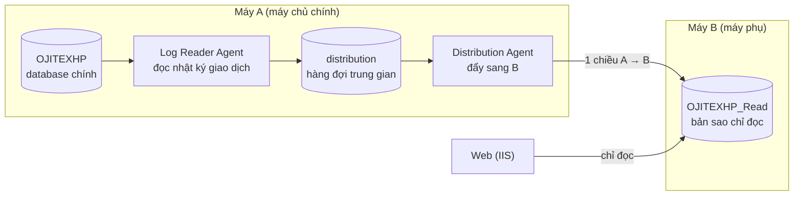
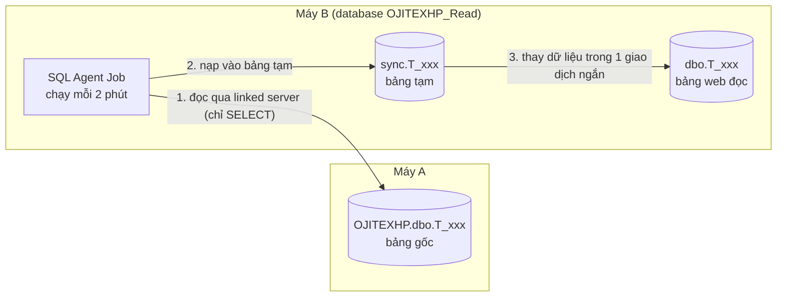

# Hướng dẫn từng bước: tạo database phụ chỉ đọc bằng Transactional Replication

Tài liệu này viết cho người **chưa từng cài replication**. Mỗi bước có: làm gì, bấm ở đâu, và **kết quả đúng phải thấy** (mục "Kiểm tra"). Chưa thấy kết quả đúng thì **dừng lại**, xem mục 12 (Lỗi thường gặp), đừng làm bước tiếp theo.

Phần lớn thao tác dùng giao diện SSMS (wizard) vì ít sai hơn gõ lệnh. Chỉ dùng T-SQL ở những chỗ nhanh và dễ kiểm tra.

---

## Mục lục

0. [Hiểu nhanh cách hoạt động](#0-hiểu-nhanh-cách-hoạt-động)
1. [Những điều cần biết về hệ thống Ojitex trước khi làm](#1-những-điều-cần-biết-về-hệ-thống-ojitex-trước-khi-làm)
2. [Phiếu thông tin: điền trước khi bắt đầu](#2-phiếu-thông-tin-điền-trước-khi-bắt-đầu)
3. [Giai đoạn 1: Chuẩn bị hai máy](#3-giai-đoạn-1-chuẩn-bị-hai-máy)
4. [Giai đoạn 2: Chuẩn bị database đích trên máy B](#4-giai-đoạn-2-chuẩn-bị-database-đích-trên-máy-b)
5. [Giai đoạn 3: Bật Distributor trên máy A](#5-giai-đoạn-3-bật-distributor-trên-máy-a)
6. [Giai đoạn 4: Tạo Publication trên máy A](#6-giai-đoạn-4-tạo-publication-trên-máy-a)
7. [Giai đoạn 5: Tạo Subscription (đẩy dữ liệu sang B)](#7-giai-đoạn-5-tạo-subscription-đẩy-dữ-liệu-sang-b)
8. [Giai đoạn 6: Kiểm tra dữ liệu đã giống 100%](#8-giai-đoạn-6-kiểm-tra-dữ-liệu-đã-giống-100)
9. [Giai đoạn 7: Tạo tài khoản chỉ đọc cho web](#9-giai-đoạn-7-tạo-tài-khoản-chỉ-đọc-cho-web)
10. [Giai đoạn 8: Đổi web sang dùng máy B](#10-giai-đoạn-8-đổi-web-sang-dùng-máy-b)
11. [Vận hành hằng ngày](#11-vận-hành-hằng-ngày)
12. [Lỗi thường gặp](#12-lỗi-thường-gặp)
13. [Gỡ bỏ để làm lại](#13-gỡ-bỏ-để-làm-lại)
14. [Checklist cuối cùng](#14-checklist-cuối-cùng)
15. [Phụ lục A: bảng không có khóa chính](#phụ-lục-a-bảng-không-có-khóa-chính)
16. [Phụ lục B: database EVOLIO (web có ghi dữ liệu)](#phụ-lục-b-database-evolio-web-có-ghi-dữ-liệu)
17. [Phụ lục C: đồng bộ bảng không có khóa chính bằng job (Cách 2 chi tiết)](#phụ-lục-c-đồng-bộ-bảng-không-có-khóa-chính-bằng-job-cách-2-chi-tiết)

---

## 0. Hiểu nhanh cách hoạt động



Giải thích các từ sẽ gặp:

| Từ | Nghĩa dễ hiểu |
|---|---|
| **Publisher** | Máy có dữ liệu gốc. Ở đây là **A**. |
| **Distributor** | Nơi trung chuyển dữ liệu (database tên `distribution`). Đặt luôn trên **A** cho đơn giản. |
| **Subscriber** | Máy nhận bản sao. Ở đây là **B**. |
| **Publication** | "Gói" các bảng sẽ được sao chép. |
| **Subscription** | Việc B đăng ký nhận gói đó. |
| **Snapshot** | Ảnh chụp toàn bộ dữ liệu, dùng **một lần đầu** để B có dữ liệu ban đầu. |
| **Agent** | Tiến trình tự chạy nền (thực chất là các Job của SQL Server Agent). |

Cách dữ liệu đi: sau lần chép ban đầu (snapshot), mỗi thay đổi ở A (thêm/sửa/xóa) được **Log Reader** đọc từ nhật ký giao dịch, bỏ vào `distribution`, rồi **Distribution Agent** áp sang B. Trong mạng LAN, độ trễ thường **vài giây**. Replication chỉ đọc nhật ký của A, **không ghi gì vào bảng dữ liệu của A**.

### Những gì sẽ thay đổi trên máy A (cần biết để yên tâm)

- Thêm database hệ thống `distribution` và vài SQL Agent job tên bắt đầu bằng tên máy hoặc `Pub_...`.
- Nhật ký giao dịch (`.ldf`) của database nguồn **không được dọn** cho đến khi Log Reader đọc xong. Nếu Agent dừng lâu, file log phình to (xem mục 11).
- Một ít CPU và đĩa dùng thêm. Không đổi dữ liệu và không đổi cấu trúc bảng (trừ khi bạn chọn thêm khóa chính ở Phụ lục A).

### Điều quan trọng cần hiểu đúng

> [!IMPORTANT]
> - Replication **không phải là backup**. Xóa nhầm ở A thì B cũng bị xóa ngay. Vẫn phải backup A như bình thường.
> - Database trên B **chỉ được ghi bởi replication**. Nếu bất kỳ ai/ứng dụng nào ghi vào B, replication sẽ lỗi (mục 12).
> - **Không** bật `READ_ONLY` cho database trên B (Agent cần ghi vào). Chỉ-đọc được đảm bảo bằng **quyền của tài khoản web** (mục 9).

---

## 1. Những điều cần biết về hệ thống Ojitex trước khi làm

Mã nguồn hiện tại của dự án dùng **2 database** (xem [README](../README.md)). Đã kiểm tra mã nguồn:

| Database | Dùng để làm gì | Web có ghi không? | Cách xử lý |
|---|---|---|---|
| `OJITEXHP` | Dữ liệu sản xuất, tồn kho | **Không ghi** (không có chỗ nào gọi lưu dữ liệu trong `ProductionContext`) | **Sao chép bằng replication** sang `OJITEXHP_Read` (hướng dẫn chính) |
| `EVOLIO` | Tài khoản, phân quyền | **Có ghi**: tạo/sửa người dùng, lịch sử đăng nhập, chuyển mật khẩu cũ | **Không** thể chỉ-đọc. Xem [Phụ lục B](#phụ-lục-b-database-evolio-web-có-ghi-dữ-liệu) và **chọn phương án** |

Hệ quả: nếu bạn chuyển `EVOLIO` sang bản sao chỉ-đọc, **đăng nhập web sẽ lỗi 500**. Vì vậy hướng dẫn chính chỉ replicate `OJITEXHP`, còn `EVOLIO` bạn quyết định theo Phụ lục B.

Ba điều khác phát hiện trong mã nguồn:

1. **Bảng không có khóa chính.** `T_Converting_Online_Report` và `T_Corrugator_Online_Report` được khai báo `HasNoKey()`, nghĩa là rất có thể bảng đó không có PRIMARY KEY trong SQL Server. Transactional replication **không sao chép được bảng không có khóa chính**. Xem [Phụ lục A](#phụ-lục-a-bảng-không-có-khóa-chính). Mục 3.9 sẽ liệt kê chính xác bảng nào bị ảnh hưởng.
2. **Trigger.** Có bảng gắn trigger (ví dụ `T_Acceptance_Download`). Replication mặc định **không copy trigger** sang B, và bạn **nên giữ nguyên mặc định đó** (nếu trigger chạy cả ở B sẽ ghi thêm dữ liệu, gây lỗi).
3. **Tài khoản `sa`.** Chuỗi kết nối hiện tại đang dùng `sa`. Tài khoản này có toàn quyền, trái với mục tiêu giảm rủi ro. Sau khi xong, web phải dùng tài khoản riêng (mục 9–10). Mật khẩu `sa` đã nằm trong file cấu hình local, nên cân nhắc đổi sau khi chuyển xong.

---

## 2. Phiếu thông tin: điền trước khi bắt đầu

In ra hoặc ghi lại. Toàn bộ tài liệu dùng các **tên ví dụ** ở cột 2; bạn thay bằng giá trị thật mỗi khi gặp.

| Thông tin | Ví dụ trong tài liệu | Giá trị thật của bạn | Cách lấy |
|---|---|---|---|
| Tên máy A | `SQLA` | ______ | Mở PowerShell trên A, gõ `hostname` |
| IP máy A | `192.168.1.10` | ______ | `ipconfig`, dòng *IPv4 Address*. (Cấu hình hiện tại của web trỏ tới `172.88.0.101`, hãy xác nhận đó có phải máy A) |
| Tên máy B | `SQLB` | ______ | PowerShell trên B, gõ `hostname` |
| IP máy B | `192.168.1.11` | ______ | `ipconfig` trên B |
| Port SQL Server | `1433` | ______ | Mục 3.5 |
| Database nguồn | `OJITEXHP` | ______ | Tên database trên A |
| Database đích | `OJITEXHP_Read` | ______ | Tự đặt. Đề nghị: tên nguồn + `_Read` |
| Tên publication | `Pub_OJITEXHP` | ______ | Tự đặt |
| Tài khoản replication trên B | `repl_link` | ______ | Tự đặt ở mục 4.2 |
| Tài khoản chỉ-đọc cho web | `web_reader` | ______ | Tự đặt ở mục 9 |
| Mật khẩu hai tài khoản trên | ______ | ______ | Tự đặt, **mật khẩu mạnh, khác nhau**, ghi vào nơi an toàn, không ghi vào mã nguồn |

Cần có: quyền Administrator Windows trên cả hai máy, quyền `sysadmin` trên SQL Server cả hai máy, **SSMS** cài trên máy A (SSMS có thể kết nối tới B từ A, không cần cài thêm ở B).

> [!TIP]
> Nên làm ngoài giờ làm việc. Bước tạo snapshot (mục 6–7) đọc toàn bộ database nên có thể làm A chậm hơn một lúc, tùy dung lượng.

---

## 3. Giai đoạn 1: Chuẩn bị hai máy

### 3.1. Xác nhận tên máy và IP

Trên **mỗi máy**, mở PowerShell (Start → gõ `PowerShell` → mở) và chạy:

```powershell
hostname
ipconfig
```

Ghi tên máy và IPv4 vào phiếu ở mục 2.

> [!TIP]
> Nên đặt **IP tĩnh** cho hai máy (hoặc DHCP reservation trên router). Nếu IP đổi mà bạn đã ghi cứng vào file `hosts`, hệ thống sẽ hỏng.

### 3.2. Kiểm tra hai máy gọi nhau bằng tên

Trên A: `ping SQLB`. Trên B: `ping SQLA`. (Thay bằng tên máy thật.)

- **Thấy `Reply from <IP đúng của máy kia>`:** xong, nhảy sang 3.4.
- **Thấy `could not find host` hoặc ra IP lạ:** làm bước 3.3.
- **Thấy `Request timed out` nhưng ra đúng IP:** máy kia chặn ping (bình thường trên Windows Server). Không sao, kiểm tra thật ở mục 3.4 bằng port 1433.

### 3.3. Thêm tên máy vào file `hosts` (chỉ khi 3.2 không ra)

Làm trên **cả hai máy**:

1. Start → gõ `Notepad` → **chuột phải → Run as administrator**.
2. File → Open → dán `C:\Windows\System32\drivers\etc\hosts` → Enter. (Ô loại file đổi từ *Text Documents* sang **All Files**.)
3. Kéo xuống **cuối file**, thêm một dòng:
   - Trên **A**: `192.168.1.11    SQLB` (IP của B, tên máy B)
   - Trên **B**: `192.168.1.10    SQLA` (IP của A, tên máy A)
4. Lưu (Ctrl+S). Lỗi không lưu được nghĩa là Notepad chưa chạy bằng quyền Administrator.
5. Ping lại như 3.2. Không ăn thì chạy `ipconfig /flushdns` rồi ping lại.

### 3.4. Mở firewall và kiểm tra thông cổng

Replication cần máy A kết nối được SQL Server của B, và web/SSMS cần kết nối được B. Mở cổng SQL (mặc định TCP 1433).

Trên **B** (PowerShell chạy bằng Administrator), cho phép A và máy web vào:

```powershell
New-NetFirewallRule -DisplayName "SQL Server 1433 from A and Web" -Direction Inbound -Protocol TCP -LocalPort 1433 -RemoteAddress 192.168.1.10,<IP_MAY_WEB> -Action Allow
```

Nếu web chạy cùng máy B thì bỏ `<IP_MAY_WEB>`. Trên **A**, cho phép B vào (B đôi khi cần kết nối ngược lại):

```powershell
New-NetFirewallRule -DisplayName "SQL Server 1433 from B" -Direction Inbound -Protocol TCP -LocalPort 1433 -RemoteAddress 192.168.1.11 -Action Allow
```

**Kiểm tra:** từ A chạy `Test-NetConnection SQLB -Port 1433`, từ B chạy `Test-NetConnection SQLA -Port 1433`. Cả hai phải ra `TcpTestSucceeded : True`. Nếu `False`, xem 3.5 và firewall.

### 3.5. Bật TCP/IP và xác nhận cổng SQL Server (làm trên cả hai máy)

1. Start → gõ **SQL Server Configuration Manager** → mở.
2. Bên trái: *SQL Server Network Configuration* → *Protocols for MSSQLSERVER* (instance mặc định; instance có tên thì chọn tên đó).
3. Dòng **TCP/IP** phải là **Enabled**. Nếu Disabled: chuột phải → Enable.
4. Chuột phải TCP/IP → Properties → tab **IP Addresses** → kéo xuống cuối, phần **IPAll**, xem ô **TCP Port**. Thường là `1433`. Ghi cổng thật vào phiếu.
5. Nếu vừa đổi gì, restart dịch vụ: bên trái *SQL Server Services* → chuột phải *SQL Server (MSSQLSERVER)* → Restart.

### 3.6. Bật SQL Server Agent (cả hai máy)

Replication chạy bằng SQL Server Agent.

1. Start → gõ `services.msc`.
2. Tìm **SQL Server Agent (MSSQLSERVER)** → chuột phải → Properties.
3. *Startup type* = **Automatic** → bấm **Start** → OK.

**Kiểm tra:** cột Status là **Running**. Làm trên cả A và B (B không bắt buộc cho kiểu push, nhưng nên bật).

### 3.7. Cho phép đăng nhập SQL (SQL Authentication) trên B

Ta sẽ dùng tài khoản SQL (không cần domain) để máy A đẩy dữ liệu sang B.

1. Mở SSMS trên A, **Connect** tới B: Server name `SQLB`, Authentication *Windows* (nếu hai máy không cùng domain, dùng tài khoản `sa` của B).
2. Chuột phải tên server B (trên cùng Object Explorer) → **Properties** → trang **Security**.
3. Chọn **SQL Server and Windows Authentication mode** → OK.
4. Nếu SSMS báo cần restart, restart dịch vụ SQL Server trên B (Configuration Manager → Restart).

### 3.8. Kiểm tra tên server SQL trên A và B

Replication **bắt buộc** `@@SERVERNAME` trùng đúng tên máy. Nếu khác, wizard sẽ báo lỗi ở bước sau.

Mở **New Query** trên **A** (nhớ kết nối vào A), chạy:

```sql
SELECT @@SERVERNAME AS ten_sql, SERVERPROPERTY('MachineName') AS ten_may, SERVERPROPERTY('Edition') AS ban, SERVERPROPERTY('ProductVersion') AS phien_ban;
```

- **`ten_sql` giống `ten_may`:** đạt. (Instance mặc định thì hai giá trị giống hệt.)
- **Khác nhau hoặc `ten_sql` là NULL:** sửa như sau rồi **restart SQL Server**, chạy lại truy vấn trên để kiểm tra:

  ```sql
  -- Chỉ chạy dòng DROP nếu ten_sql không NULL
  DECLARE @old sysname = @@SERVERNAME;
  EXEC sp_dropserver @old;
  EXEC sp_addserver @server = N'SQLA', @local = 'local';   -- SQLA = tên máy thật của A
  ```

Làm **y hệt trên B** (tên máy B). Ghi lại `ban` và `phien_ban` của hai máy: `ban` ở A phải là Enterprise (như bạn nói); B nên cùng phiên bản chính (năm) hoặc cao hơn A.

### 3.9. Kiểm tra bảng nào không có khóa chính (rất quan trọng)

Trên **A**, New Query, chạy:

```sql
USE OJITEXHP;
GO
SELECT s.name AS [schema], t.name AS [bang]
FROM sys.tables t
JOIN sys.schemas s ON s.schema_id = t.schema_id
WHERE t.is_ms_shipped = 0
  AND OBJECTPROPERTY(t.object_id, 'TableHasPrimaryKey') = 0
ORDER BY s.name, t.name;
```

- **Không ra dòng nào:** tốt, qua bước kế.
- **Ra các dòng:** đây là bảng **không được replication sao chép**. Mỗi bảng, bạn phải chọn một cách ở [Phụ lục A](#phụ-lục-a-bảng-không-có-khóa-chính) **trước khi** sang giai đoạn 4. Ghi lại danh sách.

### 3.10. Kiểm tra chủ sở hữu (owner) của database nguồn

Nếu database nguồn không có owner hợp lệ, Log Reader Agent sẽ lỗi. Trên A:

```sql
SELECT name, SUSER_SNAME(owner_sid) AS chu_so_huu FROM sys.databases WHERE name = N'OJITEXHP';
```

Nếu `chu_so_huu` là **NULL**, sửa:

```sql
ALTER AUTHORIZATION ON DATABASE::OJITEXHP TO sa;
```

### 3.11. Sao lưu trước khi bắt đầu (khuyến nghị)

Trên A, tạo bản backup riêng (không ảnh hưởng chuỗi backup đang chạy nhờ `COPY_ONLY`):

```sql
BACKUP DATABASE OJITEXHP TO DISK = N'D:\Backup\OJITEXHP_truoc_replication.bak'
WITH COPY_ONLY, COMPRESSION, CHECKSUM, STATS = 10;
```

Đổi `D:\Backup` thành thư mục có thật và còn dung lượng. Xem dung lượng database: `USE OJITEXHP; EXEC sp_spaceused;` (cần ổ đĩa trống ít nhất bằng dung lượng này cho snapshot, trên A và B).

---

## 4. Giai đoạn 2: Chuẩn bị database đích trên máy B

### 4.1. Tạo database rỗng

Kiểm tra collation (kiểu so sánh chữ) của nguồn, chạy trên **A**:

```sql
SELECT DATABASEPROPERTYEX(N'OJITEXHP', 'Collation') AS collation_nguon;
```

Ghi lại kết quả (ví dụ `SQL_Latin1_General_CP1_CI_AS` hoặc `Vietnamese_CI_AS`). Rồi trên **B** (New Query kết nối vào B):

```sql
CREATE DATABASE OJITEXHP_Read COLLATE SQL_Latin1_General_CP1_CI_AS;  -- thay bằng collation_nguon ở trên
GO
ALTER DATABASE OJITEXHP_Read SET RECOVERY SIMPLE;
```

Giữ database **trống**. Không tạo bảng, không restore vào đây. Replication tự tạo bảng khi chạy snapshot.

### 4.2. Tạo tài khoản để A đẩy dữ liệu sang B

Trên **B**:

```sql
USE master;
GO
CREATE LOGIN repl_link WITH PASSWORD = N'<MAT_KHAU_MANH_1>', CHECK_POLICY = ON;
GO
USE OJITEXHP_Read;
GO
CREATE USER repl_link FOR LOGIN repl_link;
ALTER ROLE db_owner ADD MEMBER repl_link;
```

Thay `<MAT_KHAU_MANH_1>` bằng mật khẩu thật (ít nhất 12 ký tự, có chữ hoa/thường/số/ký hiệu). Tài khoản này **chỉ** có quyền trong `OJITEXHP_Read` của B, không có đường nào vào A.

**Kiểm tra:** SSMS → Connect → Authentication *SQL Server Authentication*, login `repl_link`, server `SQLB`. Kết nối được và thấy database `OJITEXHP_Read` là đạt. Ngắt kết nối sau khi thử.

---

## 5. Giai đoạn 3: Bật Distributor trên máy A

Làm trong SSMS đang kết nối **A**. (Phải kết nối bằng **tên máy** `SQLA`, không dùng IP hay alias, nếu không wizard báo lỗi.)

1. Object Explorer, chuột phải thư mục **Replication** → **Configure Distribution…**
2. **Welcome** → Next.
3. **Distributor:** chọn dòng đầu tiên: *`SQLA` will act as its own Distributor; SQL Server will create a distribution database and log* → Next.
   - Nếu hiện hộp thoại hỏi bật SQL Server Agent tự khởi động: chọn **Yes**.
4. **Snapshot Folder:** giữ nguyên đường dẫn mặc định (dạng `C:\Program Files\Microsoft SQL Server\MSSQL16.MSSQLSERVER\MSSQL\ReplData`). Nếu hiện cảnh báo *"The specified snapshot folder is not a network path..."* bấm **Yes/Continue**, vì ta dùng kiểu **push** nên không cần đường dẫn mạng. Next.
5. **Distribution Database:** giữ tên `distribution` và thư mục mặc định → Next. (Nếu ổ C: sắp đầy, đổi sang ổ khác có nhiều chỗ.)
6. **Publishers:** danh sách đã có sẵn `SQLA`, **tick** nếu chưa tick → Next.
7. **Wizard Actions:** tick **Configure distribution** → Next.
8. **Complete the Wizard** → **Finish**.

**Kiểm tra:** cửa sổ kết quả phải toàn dấu ✔ *Success*. Bấm **Close**. Trong Object Explorer, mở *Databases → System Databases*: thấy database **`distribution`**. Chuột phải thư mục **Replication** → *Distributor Properties*: thấy `SQLA` là Publisher đã bật.

---

## 6. Giai đoạn 4: Tạo Publication trên máy A

1. Object Explorer: mở **Replication**, chuột phải **Local Publications** → **New Publication…**
2. **Welcome** → Next.
3. **Publication Database:** chọn **`OJITEXHP`** → Next.
4. **Publication Type:** chọn **Transactional publication** → Next.
5. **Articles** (chọn các bảng cần sao chép):
   - Mở nhánh **Tables**. Tick ô **Tables** ngoài cùng để chọn toàn bộ.
   - Bảng **không có khóa chính** sẽ **mờ** (không tick được). Đối chiếu với danh sách ở mục 3.9, xử lý theo Phụ lục A.
   - Bỏ tick các bảng không cần dùng trên web (nếu có). Không chắc thì cứ để lại hết.
   - **Views / Stored Procedures / User-Defined Functions:** mã nguồn hiện không dùng, bạn không cần tick. Nếu về sau web dùng, quay lại thêm (mục 11).
   - **Nên làm:** bấm **Article Properties** → **Set Properties of All Table Articles** → tìm **Copy nonclustered indexes** = **True** (để truy vấn ở B nhanh như ở A), **Copy triggers** = **False** (giữ nguyên) → OK.
   - Next.
6. **Filter Table Rows:** không lọc gì → Next. (Cần đúng 100% dữ liệu.)
7. **Snapshot Agent:** tick **Create a snapshot immediately and keep the snapshot available to initialize subscriptions**. **Bỏ tick** ô lịch chạy định kỳ ("Schedule the Snapshot Agent...") → Next.
8. **Agent Security:**
   - Bấm nút **Security Settings…** ở mục *Snapshot Agent*.
   - Chọn **Run under the SQL Server Agent service account**.
   - Phần *Connect to the Publisher*: chọn **By impersonating the process account** → OK.
   - Dưới đó tick **Use the security settings from the Snapshot Agent** cho Log Reader Agent (nếu có tùy chọn này) → Next.
9. **Wizard Actions:** tick **Create the publication** → Next.
10. **Complete the Wizard:** ô **Publication name** nhập `Pub_OJITEXHP` → xem lại danh sách → **Finish**.

**Kiểm tra:** tất cả dòng *Success*. Bấm **Close**. Dưới *Local Publications* thấy `[OJITEXHP]: Pub_OJITEXHP`.

Snapshot bắt đầu chạy ngay ở nền. Theo dõi: chuột phải `Pub_OJITEXHP` → **View Snapshot Agent Status**. Chờ đến khi thấy *"A snapshot of 'N' article(s) was generated"* (N = số bảng) thì xong. Database lớn thì chờ vài phút đến vài chục phút. **Đừng sang bước sau khi chưa thấy dòng này.**

---

## 7. Giai đoạn 5: Tạo Subscription (đẩy dữ liệu sang B)

1. Object Explorer: *Replication → Local Publications* → chuột phải `[OJITEXHP]: Pub_OJITEXHP` → **New Subscriptions…**
2. **Welcome** → Next.
3. **Publication:** giữ `Pub_OJITEXHP` → Next.
4. **Distribution Agent Location:** chọn **Run all agents at the Distributor (push subscriptions)** → Next.
5. **Subscribers:**
   - Bấm **Add Subscriber…** → **Add SQL Server Subscriber…**
   - Cửa sổ Connect: Server name `SQLB`, Authentication chọn cách đã dùng ở 3.7 (Windows hoặc `sa` của B) → **Connect**.
   - Ở cột **Subscription Database** của dòng `SQLB`, chọn **`OJITEXHP_Read`** (không chọn *New database*).
   - Next.
6. **Distribution Agent Security:** bấm nút **…** ở cuối dòng.
   - *Run under the SQL Server Agent service account* (tick).
   - *Connect to the Distributor:* **By impersonating the process account**.
   - *Connect to the Subscriber:* **Using the following SQL Server login** → Login `repl_link`, Password là mật khẩu ở mục 4.2, nhập lại ở ô Confirm.
   - OK → Next.
7. **Synchronization Schedule:** cột *Agent Schedule* chọn **Run continuously** → Next. (Đây là điều giúp gần thời gian thực.)
8. **Initialize Subscriptions:** cột *Initialize* tick, cột *Initialize When* chọn **Immediately** → Next.
9. **Wizard Actions:** tick **Create the subscription(s)** → Next.
10. **Complete the Wizard** → **Finish**.

**Kiểm tra:** toàn *Success*, Close. Chuột phải `Pub_OJITEXHP` → **View Synchronization Status** hoặc mở Replication Monitor (mục 8.1). Chờ đến khi thấy thông báo dạng *"No replicated transactions are available"* hoặc *"Delivering replicated transactions"*. Lần đầu có thể mất một lúc vì phải áp snapshot sang B.

---

## 8. Giai đoạn 6: Kiểm tra dữ liệu đã giống 100%

### 8.1. Mở Replication Monitor và xem trạng thái

Chuột phải **Replication** (hoặc `Pub_OJITEXHP`) → **Launch Replication Monitor**. Bên trái: mở **My Publishers → SQLA → `[OJITEXHP]: Pub_OJITEXHP`**. Bên phải có các tab:

| Tab | Xem gì | Trạng thái tốt |
|---|---|---|
| **All Subscriptions** | Một dòng cho B | Biểu tượng **xanh**, Status *Running*, Latency vài giây |
| **Tracer Tokens** | Đo độ trễ | Xem 8.2 |
| **Agents** | Snapshot Agent, Log Reader Agent, Distribution Agent | Snapshot: *Completed*. Hai agent còn lại: *Running* |

Biểu tượng **đỏ** hoặc *Retrying failed command*: bấm vào dòng đó, xem phần thông báo lỗi, đối chiếu mục 12.

### 8.2. Đo độ trễ thực tế (không cần ghi dữ liệu vào A)

Tab **Tracer Tokens** → **Insert Tracer**. Sau vài giây các cột *Publisher to Distributor*, *Distributor to Subscriber*, *Total Latency* sẽ có số. Tổng thường **vài giây** là bình thường.

### 8.3. So sánh số dòng từng bảng

Chạy **cùng một truy vấn** trên A (database `OJITEXHP`) và trên B (database `OJITEXHP_Read`), rồi so hai kết quả:

```sql
SELECT s.name + N'.' + t.name AS bang, SUM(ps.row_count) AS so_dong
FROM sys.dm_db_partition_stats ps
JOIN sys.tables t ON t.object_id = ps.object_id
JOIN sys.schemas s ON s.schema_id = t.schema_id
WHERE ps.index_id IN (0, 1) AND t.is_ms_shipped = 0
GROUP BY s.name, t.name
ORDER BY bang;
```

Ở A đang có người dùng ghi nên vài bảng có thể lệch vài dòng trong tích tắc; chạy lại sau vài giây sẽ khớp. Bảng nào **lệch kéo dài** → xem lại bảng đó (mục 12).

Bảng có ở A nhưng **không có ở B** là bảng không có khóa chính (hoặc đã bỏ tick). Phải khớp với danh sách ở 3.9.

### 8.4. Kiểm tra bằng công cụ chính thức (Validate)

Trong Replication Monitor, tab **All Subscriptions** → chuột phải dòng subscription → **Validate Subscription…** → tick **Validate this subscription** → bấm **Options…** → chọn **Compute a binary checksum** (so sánh nội dung chính xác nhất, nặng hơn; nên chạy ngoài giờ) → OK → OK.

Sau đó mở lại subscription → chuột phải → **View Details** → xem lịch sử của Distribution Agent. Phải thấy dòng chứa **"validation succeeded"** hoặc *"passed"*. Nếu thấy *"validation failed"* thì dữ liệu hai bên lệch; cần **Reinitialize** (mục 11).

### 8.5. Thử cập nhật thực tế (tùy chọn)

Không nên cố ý sửa dữ liệu thật ở A để thử. Cách an toàn: theo dõi một bảng đang được dùng hằng ngày (ví dụ bảng nhập kho mới), chờ có dòng mới ở A và `SELECT TOP 5 ... ORDER BY <cột thời gian> DESC` trên cả A và B, thấy giống nhau sau vài giây.

---

## 9. Giai đoạn 7: Tạo tài khoản chỉ đọc cho web

Chỉ làm khi mục 8 đã đạt. Trên **B**:

```sql
USE master;
GO
CREATE LOGIN web_reader WITH PASSWORD = N'<MAT_KHAU_MANH_2>', CHECK_POLICY = ON;
GO
USE OJITEXHP_Read;
GO
CREATE USER web_reader FOR LOGIN web_reader;
ALTER ROLE db_datareader ADD MEMBER web_reader;
DENY INSERT, UPDATE, DELETE, ALTER, EXECUTE ON SCHEMA::dbo TO web_reader;
```

`<MAT_KHAU_MANH_2>` khác mật khẩu `repl_link`. `db_datareader` chỉ cho đọc; `DENY` chặn ghi dù sau này ai lỡ cấp thêm quyền.

**Kiểm tra:** mở kết nối mới bằng `web_reader` (SQL Authentication) tới `SQLB`, database `OJITEXHP_Read`, chạy:

```sql
SELECT TOP 5 * FROM dbo.T_AdjustProduct;     -- phải chạy được
DELETE FROM dbo.T_AdjustProduct WHERE 1 = 0; -- phải báo "The DELETE permission was denied"
```

Nếu `DELETE` báo bị từ chối là chuẩn: tài khoản web không thể sửa dữ liệu. (Dòng `DELETE ... WHERE 1 = 0` không xóa gì dù có quyền; nó chỉ dùng để thử quyền.)

Đồng thời, trên **A không tạo bất kỳ login nào cho web**. Nếu muốn chặt hơn, firewall A chỉ mở 1433 cho B và những máy quản trị cần thiết, không mở cho máy web.

---

## 10. Giai đoạn 8: Đổi web sang dùng máy B

Chỉ cần đổi chuỗi kết nối `OJITEXHP` của web; **không sửa mã nguồn**. Theo [README](../README.md), chuỗi kết nối nằm trong cấu hình local hoặc biến môi trường. Đặt giá trị mới:

```
Server=SQLB,1433;Database=OJITEXHP_Read;User Id=web_reader;Password=<MAT_KHAU_MANH_2>;Encrypt=True;TrustServerCertificate=True;
```

- Trên máy chủ web (IIS), file cấu hình production hoặc biến môi trường `ConnectionStrings__OJITEXHP` (hai dấu gạch dưới). Xem thêm [windows-server-deployment.md](windows-server-deployment.md).
- **Không** ghi mật khẩu vào mã nguồn hoặc commit lên git.
- Chuỗi `EVOLIO` **giữ nguyên** cho đến khi bạn quyết định ở Phụ lục B.
- Sau khi sửa, **recycle Application Pool** của web trong IIS Manager, hoặc chạy `iisreset`.

**Kiểm tra:** đăng nhập web, mở trang báo cáo tồn kho/sản xuất, dữ liệu hiển thị bình thường. Trên A, mở **Activity Monitor** hoặc `sp_who2`, thấy không còn kết nối từ máy web tới `OJITEXHP`.

---

## 11. Vận hành hằng ngày

### Kiểm tra sức khỏe nhanh (mỗi sáng hoặc khi nghi ngờ)

1. Replication Monitor: biểu tượng xanh, latency vài giây.
2. Trên A, kiểm tra log database nguồn có đang bị giữ do replication không:

   ```sql
   SELECT name, log_reuse_wait_desc FROM sys.databases WHERE name = N'OJITEXHP';
   ```

   `REPLICATION` kéo dài kèm file `.ldf` phình to nghĩa là Log Reader Agent đang dừng hoặc lỗi.
3. SQL Server Agent trên A phải luôn *Running*.

### Cảnh báo tự động (nên làm)

SQL Server Agent (trên A) → **Alerts** → New Alert → Type: *SQL Server performance condition alert* hoặc dùng sẵn *Replication: agent failure* → bật email/Database Mail. Chưa có Database Mail thì ít nhất kiểm tra tay mỗi ngày.

### Các tình huống

| Tình huống | Hệ thống làm gì / bạn làm gì |
|---|---|
| **Máy B tắt hoặc mất mạng** | A giữ các thay đổi trong `distribution` và tự đẩy tiếp khi B trở lại. Nên bật lại B **trong vòng 72 giờ** (mặc định). Quá hạn → subscription *expired* → phải Reinitialize. |
| **Máy A restart** | Agent tự chạy lại nếu SQL Server Agent đặt *Automatic*. |
| **Thêm cột / đổi kiểu cột ở A** | Tự sang B (publication mặc định sao chép thay đổi cấu trúc). |
| **Thêm bảng mới ở A** | **Không** tự sang B. Chuột phải `Pub_OJITEXHP` → **Properties** → trang **Articles** → tick bảng mới → OK; sau đó chuột phải publication → **View Snapshot Agent Status** → **Start** để tạo snapshot cho riêng bảng mới. (Bảng phải có khóa chính.) |
| **Cần thêm view/function/procedure cho B** | Cũng thêm ở trang **Articles** như trên (chỉ sao chép định nghĩa). |
| **Cần làm lại từ đầu (dữ liệu lệch, subscription hết hạn)** | Replication Monitor → chuột phải subscription → **Reinitialize Subscription** → chọn **Use a new snapshot** → Mark For Reinitialization. Rồi chuột phải publication → **View Snapshot Agent Status** → **Start**. |
| **Đổi mật khẩu `repl_link`** | Đổi ở B, rồi trên A: Replication Monitor → chuột phải subscription → Properties (hoặc Distribution Agent job) → cập nhật mật khẩu. |

Vẫn phải **backup A** định kỳ (full + log). Backup B không bắt buộc cho dữ liệu, vì có thể dựng lại bằng Reinitialize.

---

## 12. Lỗi thường gặp

| Hiện tượng / thông báo | Nguyên nhân | Cách xử lý |
|---|---|---|
| *"SQL Server replication requires the actual server name to make a connection to the server. Connections through a server alias, IP address, or any other alternate name are not supported."* | Kết nối SSMS bằng IP, alias hoặc `localhost`; hoặc `@@SERVERNAME` sai. | Ngắt kết nối, kết nối lại bằng **tên máy thật** (`SQLA`). Vẫn lỗi: làm mục 3.8. |
| Wizard không kết nối được `SQLB` (error 53, 40 hoặc timeout) | Sai tên máy, firewall chặn, TCP/IP chưa bật. | Mục 3.2–3.5. Dùng `Test-NetConnection SQLB -Port 1433`. |
| *Login failed for user 'repl_link'* | Mật khẩu sai, chưa bật chế độ Mixed, hoặc login chưa có user trong `OJITEXHP_Read`. | Mục 3.7 và 4.2. Đăng nhập thử bằng SSMS bằng chính tài khoản đó. |
| Tab Articles: nhiều bảng bị mờ, không tick được | Bảng không có khóa chính. | Phụ lục A. |
| Snapshot Agent lỗi *"The process could not connect to Distributor"* | Distributor chưa cấu hình xong hoặc SQL Agent không chạy. | Mục 3.6 và 5. |
| Snapshot Agent lỗi *Access is denied* ghi vào thư mục ReplData | Tài khoản Agent không có quyền ghi thư mục snapshot. | Cấp quyền *Modify* cho tài khoản chạy dịch vụ SQL Server Agent trên thư mục ReplData. |
| Log Reader Agent lỗi *"The process could not execute 'sp_replcmds'"* | Database nguồn không có owner. | Mục 3.10. |
| Distribution Agent lỗi *"The row was not found at the Subscriber when applying the replicated command"* hoặc lỗi trùng khóa | Có người/ứng dụng đã ghi hoặc xóa dữ liệu trực tiếp ở B. | Tìm nguồn ghi vào B và chặn (kiểm tra quyền ở mục 9), rồi Reinitialize (mục 11). |
| File `.ldf` của `OJITEXHP` trên A phình to, `log_reuse_wait_desc` = `REPLICATION` | Log Reader Agent dừng/lỗi. | Replication Monitor, tab Agents, xem lỗi và khởi động lại agent. Đừng tắt replication để "dọn log" khi chưa hiểu. |
| Subscription trạng thái *Expired* hoặc *Inactive* | B tắt quá lâu so với thời gian giữ (mặc định 72 giờ). | Reinitialize (mục 11). |
| Web đăng nhập không được, lỗi 500, sau khi đổi `EVOLIO` | `EVOLIO` đang trỏ vào bản sao chỉ-đọc nhưng web cần ghi. | Trả `EVOLIO` về chuỗi kết nối cũ hoặc chọn phương án khác ở Phụ lục B. |
| Web báo lỗi *"The SELECT permission was denied"* | `web_reader` chưa có `db_datareader` hoặc chưa tạo user trong DB. | Chạy lại mục 9, bước `CREATE USER`/`ALTER ROLE`. |

---

## 13. Gỡ bỏ để làm lại

Thứ tự: xóa subscription → xóa publication → tắt distribution.

1. Trên A: Replication → Local Publications → mở `Pub_OJITEXHP` → chuột phải subscription (`[SQLB].[OJITEXHP_Read]`) → **Delete**.
2. Chuột phải `Pub_OJITEXHP` → **Delete**.
3. Chuột phải **Replication** → **Disable Publishing and Distribution…** → *Yes, disable publishing on this server* → Next → Finish.
4. Nếu muốn tạo lại hoàn toàn: trên B, xóa database `OJITEXHP_Read`, rồi tạo lại từ mục 4.1.

---

## Phụ lục A: bảng không có khóa chính

Từ mục 3.9 bạn có danh sách bảng không có khóa chính. Với từng bảng, chọn **một** trong các cách dưới. Tôi khuyến nghị cách 1 nếu bạn được phép sửa cấu trúc ở A, cách 2 nếu không.

### Cách 1: Thêm khóa chính trên A rồi đưa vào replication (tốt nhất, thời gian thực)

Cách này **sửa cấu trúc bảng ở database chính**, nên cần bạn/quản trị ERP đồng ý và thử trên bản sao trước.

- Nếu bảng đã có sẵn cột (hoặc tổ hợp cột) **không NULL và không trùng nhau**, tạo khóa chính trên đó:

  ```sql
  ALTER TABLE dbo.T_Ten_Bang ADD CONSTRAINT PK_T_Ten_Bang PRIMARY KEY (Cot1, Cot2);
  ```

- Nếu không có cột nào phù hợp, thêm cột số tự tăng:

  ```sql
  ALTER TABLE dbo.T_Ten_Bang ADD Id BIGINT IDENTITY(1,1) NOT NULL CONSTRAINT PK_T_Ten_Bang PRIMARY KEY;
  ```

  Rủi ro: bảng bị khóa trong lúc thêm cột (bảng lớn thì lâu), và các câu lệnh `INSERT` **không liệt kê tên cột** (`INSERT INTO T VALUES (...)`) trong phần mềm khác sẽ lỗi vì thiếu giá trị cho cột mới. **Phải thử trên bản sao trước.**

Sau đó quay lại Giai đoạn 4 và tick bảng (hoặc thêm vào publication đã có theo mục 11).

### Cách 2: Không replicate bảng đó, tự đồng bộ định kỳ bằng Job (chậm hơn, không sửa A)

Dùng cho bảng nhỏ, chấp nhận trễ vài phút. B sẽ **đọc** A qua linked server bằng một tài khoản chỉ-đọc và chép đè bảng. Cách này **không sửa gì ở A**, nhưng không đạt "100% thời gian thực" cho các bảng này và làm B có kết nối tới A.

Hướng dẫn chi tiết từng lệnh: xem [Phụ lục C](#phụ-lục-c-đồng-bộ-bảng-không-có-khóa-chính-bằng-job-cách-2-chi-tiết).

### Cách 3: Chấp nhận web không có bảng đó trên B

Chỉ khi trang web không dùng bảng này. Hiện mã nguồn có khai báo cả hai bảng `T_Converting_Online_Report` và `T_Corrugator_Online_Report`, nên **khả năng cao là có dùng**; kiểm tra trước khi chọn cách này.

---

## Phụ lục B: database EVOLIO (web có ghi dữ liệu)

Mã nguồn ghi vào `EVOLIO` ở các chỗ: quản lý người dùng (thêm/sửa/xóa), cập nhật khi đăng nhập, chuyển mật khẩu cũ sang chuẩn mới. Bản sao replication là **chỉ-đọc**, nên không thể thay trực tiếp cho `EVOLIO`. Bạn cần chọn một trong ba phương án:

| Phương án | Cách làm | Ưu | Nhược |
|---|---|---|---|
| **B1. Bản sao độc lập có ghi (khuyến nghị)** | Backup `EVOLIO` từ A, restore thành `EVOLIO_WEB` trên B; web ghi vào bản này. Không replication. | Web không chạm tới A; đăng nhập chạy bình thường | Tài khoản/quyền trong `EVOLIO_WEB` **tách khỏi** `EVOLIO` gốc. Thay đổi người dùng ở A không tự sang B; web tạo người dùng mới thì A không biết |
| **B2. Web vẫn dùng `EVOLIO` trên A** với login quyền hẹp | Tạo login riêng trên A chỉ có quyền đọc/ghi đúng các bảng cần | Dữ liệu tài khoản luôn là bản gốc | Web vẫn có đường ghi vào A (chỉ vào `EVOLIO`, không vào `OJITEXHP`) |
| **B3. Replicate `EVOLIO` chỉ-đọc** | Làm lại quy trình trên cho `EVOLIO` → `EVOLIO_Read` | Đồng bộ thật | Phải **sửa mã nguồn** để web không ghi lịch sử đăng nhập, không chuyển mật khẩu, không có chức năng sửa người dùng trên bản web. Không thuộc phạm vi tài liệu này |

### Làm phương án B1 (nếu chọn)

Trên **A** (không ảnh hưởng chuỗi backup nhờ `COPY_ONLY`):

```sql
BACKUP DATABASE EVOLIO TO DISK = N'D:\Backup\EVOLIO_web.bak'
WITH COPY_ONLY, COMPRESSION, CHECKSUM, STATS = 10;
```

Chép file `.bak` sang B (ví dụ vào `D:\Backup` trên B). Trên **B**, xem tên logic của file:

```sql
RESTORE FILELISTONLY FROM DISK = N'D:\Backup\EVOLIO_web.bak';
```

Ghi lại cột `LogicalName` của dòng loại `D` (data) và `L` (log), rồi restore (đổi hai tên logic và đường dẫn cho đúng):

```sql
RESTORE DATABASE EVOLIO_WEB FROM DISK = N'D:\Backup\EVOLIO_web.bak'
WITH MOVE N'<TEN_LOGIC_DATA>' TO N'D:\SQLData\EVOLIO_WEB.mdf',
     MOVE N'<TEN_LOGIC_LOG>'  TO N'D:\SQLLog\EVOLIO_WEB_log.ldf',
     RECOVERY, STATS = 10;
GO
USE master;
CREATE LOGIN web_app WITH PASSWORD = N'<MAT_KHAU_MANH_3>', CHECK_POLICY = ON;
GO
USE EVOLIO_WEB;
CREATE USER web_app FOR LOGIN web_app;
ALTER ROLE db_datareader ADD MEMBER web_app;
ALTER ROLE db_datawriter ADD MEMBER web_app;
```

Rồi đổi chuỗi `EVOLIO` của web sang `Server=SQLB,1433;Database=EVOLIO_WEB;User Id=web_app;Password=...;Encrypt=True;TrustServerCertificate=True;`, recycle Application Pool và đăng nhập thử.

> [!WARNING]
> Với B1, người dùng web tạo/sửa trong `EVOLIO_WEB` **không** quay về A, và ngược lại. Hãy chắc chắn quy trình quản lý tài khoản của công ty chấp nhận điều này trước khi chọn.

---

## 14. Checklist cuối cùng

Đánh dấu từng mục, **tất cả** phải đạt:

- [ ] A và B gọi nhau bằng tên máy, `Test-NetConnection ... -Port 1433` ra `True` hai chiều
- [ ] SQL Server Agent trên hai máy: *Automatic* và *Running*
- [ ] `@@SERVERNAME` trùng tên máy trên cả A và B
- [ ] Đã xử lý hết bảng không có khóa chính (Phụ lục A) hoặc ghi nhận rõ bảng nào bỏ qua
- [ ] Distributor cấu hình xong, thấy database `distribution`
- [ ] Publication `Pub_OJITEXHP` tạo xong, snapshot đã hoàn tất
- [ ] Subscription tạo xong, *Run continuously*, Replication Monitor biểu tượng xanh
- [ ] Số dòng các bảng khớp giữa A và B; Validate Subscription báo thành công
- [ ] Tracer Token: độ trễ vài giây
- [ ] `web_reader` đọc được, `DELETE` bị từ chối
- [ ] Web trỏ `OJITEXHP` vào B bằng `web_reader`, dùng bình thường
- [ ] Quyết định xong phương án cho `EVOLIO` (Phụ lục B) và web đăng nhập được
- [ ] Web không còn dùng tài khoản `sa`
- [ ] Vẫn có lịch backup cho A; có cảnh báo khi Agent replication lỗi

---

## Phụ lục C: đồng bộ bảng không có khóa chính bằng job (Cách 2 chi tiết)

Dùng cho các bảng ở mục 3.9 (ví dụ `T_Converting_Online_Report`, `T_Corrugator_Online_Report`) mà bạn **không** thêm khóa chính ở A. Làm **sau** khi replication chính (mục 3–8) đã chạy ổn.

### C.0. Cách hoạt động



Mỗi lần chạy, job copy **toàn bộ** bảng từ A sang B. Nên chỉ dùng cho bảng **nhỏ** (vài chục nghìn đến vài trăm nghìn dòng). Dữ liệu ở B trễ tối đa bằng chu kỳ job (ví dụ 2 phút).

Vì sao có bảng tạm: đọc từ A mất thời gian (qua mạng). Nếu xóa bảng thật rồi mới đọc, web sẽ thấy bảng trống trong lúc đó. Cách làm này đọc xong vào bảng tạm **trước**, rồi mới thay bảng thật trong vài phần giây. Nếu việc đọc từ A bị lỗi, bảng thật ở B **giữ nguyên** dữ liệu cũ.

**Tác động lên A:** chỉ có câu `SELECT` từ tài khoản `repl_reader`, không ghi, không sửa cấu trúc. Mỗi lần chạy A phải đọc cả bảng, nên với bảng nhỏ là không đáng kể.

> [!IMPORTANT]
> - Thay `<DANH_SACH_BANG>` bằng đúng bảng từ mục 3.9. Các ví dụ dưới dùng 2 bảng `T_Converting_Online_Report` và `T_Corrugator_Online_Report`. Thêm/bớt dòng cho khớp.
> - Trước khi làm, kiểm tra dung lượng bảng trên **A**: `USE OJITEXHP; EXEC sp_spaceused N'dbo.T_Converting_Online_Report';`. Bảng hàng triệu dòng thì cách này chậm, nên cân nhắc thêm khóa chính (Cách 1).
> - Các bảng này **không** được tick vào publication ở mục 6 (chúng vốn bị mờ).

### C.1. Trên A: tạo tài khoản chỉ được SELECT hai bảng

Mở SSMS kết nối **A** (bằng tên máy), New Query:

```sql
USE master;
GO
CREATE LOGIN repl_reader WITH PASSWORD = N'<MAT_KHAU_MANH_4>', CHECK_POLICY = ON;
GO
USE OJITEXHP;
GO
CREATE USER repl_reader FOR LOGIN repl_reader;
-- Chỉ cấp SELECT đúng các bảng cần, không cấp db_datareader
GRANT SELECT ON OBJECT::dbo.T_Converting_Online_Report TO repl_reader;
GRANT SELECT ON OBJECT::dbo.T_Corrugator_Online_Report TO repl_reader;
```

`<MAT_KHAU_MANH_4>`: mật khẩu mạnh, khác các mật khẩu khác. Tài khoản này không đọc được bảng nào khác và không ghi được gì.

Firewall A đã mở cho B ở mục 3.4 (rule "from B"). Chưa mở thì làm lại mục đó.

**Kiểm tra:** đăng nhập SSMS bằng `repl_reader` (SQL Authentication) vào `SQLA`. Chạy `SELECT TOP 1 * FROM OJITEXHP.dbo.T_Converting_Online_Report;` phải được. Thử `SELECT TOP 1 * FROM OJITEXHP.dbo.T_AdjustProduct;` phải báo *SELECT permission was denied*. Thấy cả hai đúng như vậy là đạt.

### C.2. Trên B: tạo linked server trỏ về A

Mở SSMS kết nối **B**, New Query. Linked server là "đường dẫn" để B đọc dữ liệu A. Đặt tên `SQLA_RO` (RO = read only):

```sql
USE master;
GO
EXEC sp_addlinkedserver
     @server     = N'SQLA_RO',
     @srvproduct = N'',
     @provider   = N'MSOLEDBSQL',
     @datasrc    = N'SQLA',                         -- tên máy A (có thể thêm port: N'SQLA,1433')
     @provstr    = N'TrustServerCertificate=yes';   -- LAN, chứng chỉ tự ký
GO
EXEC sp_addlinkedsrvlogin
     @rmtsrvname  = N'SQLA_RO',
     @useself     = N'False',
     @locallogin  = NULL,
     @rmtuser     = N'repl_reader',
     @rmtpassword = N'<MAT_KHAU_MANH_4>';
GO
-- Không cho linked server này chạy lệnh từ xa ngoài SELECT thông thường
EXEC sp_serveroption N'SQLA_RO', 'rpc out', 'false';
EXEC sp_serveroption N'SQLA_RO', 'data access', 'true';
```

**Kiểm tra** (vẫn trên B):

```sql
SELECT TOP 5 * FROM SQLA_RO.OJITEXHP.dbo.T_Converting_Online_Report;
```

Phải ra dữ liệu. Nếu lỗi:

| Thông báo | Cách xử lý |
|---|---|
| *Provider "MSOLEDBSQL" is not registered* | Máy B chưa có driver. Cài **Microsoft OLE DB Driver for SQL Server** (tải từ Microsoft), rồi xóa linked server (`EXEC sp_dropserver N'SQLA_RO', 'droplogins';`) và làm lại. |
| *Login failed for user 'repl_reader'* | Sai mật khẩu hoặc A chưa bật Mixed mode (kiểm tra như mục 3.7 nhưng ở A). |
| *SSL Provider: certificate chain was issued by an authority that is not trusted* | Chưa có `TrustServerCertificate=yes` trong `@provstr`. Xóa và tạo lại linked server như trên. |
| *Named Pipes ... error 53 / timeout* | Firewall A chặn B hoặc sai tên máy. Chạy `Test-NetConnection SQLA -Port 1433` trên B. |

### C.3. Trên B: tạo bảng đích và bảng tạm

Vẫn trên **B**. Lệnh `SELECT TOP 0 ... INTO` tạo bảng rỗng **đúng cột và kiểu dữ liệu** như bảng ở A (không copy chỉ mục và ràng buộc).

```sql
USE OJITEXHP_Read;
GO
CREATE SCHEMA sync;   -- nơi chứa bảng tạm, bảng log và thủ tục đồng bộ
GO

-- Bảng web sẽ đọc (đúng tên và schema như ở A)
SELECT TOP 0 * INTO dbo.T_Converting_Online_Report FROM SQLA_RO.OJITEXHP.dbo.T_Converting_Online_Report;
SELECT TOP 0 * INTO dbo.T_Corrugator_Online_Report FROM SQLA_RO.OJITEXHP.dbo.T_Corrugator_Online_Report;

-- Bảng tạm cùng cấu trúc
SELECT TOP 0 * INTO sync.T_Converting_Online_Report FROM dbo.T_Converting_Online_Report;
SELECT TOP 0 * INTO sync.T_Corrugator_Online_Report FROM dbo.T_Corrugator_Online_Report;
GO

-- Nhật ký chạy
CREATE TABLE sync.RefreshLog (
    Id           BIGINT IDENTITY(1,1) PRIMARY KEY,
    TableName    sysname        NOT NULL,
    StartedAt    DATETIME2(0)   NOT NULL,
    FinishedAt   DATETIME2(0)   NULL,
    RowsCopied   INT            NULL,
    Succeeded    BIT            NOT NULL,
    ErrorMessage NVARCHAR(4000) NULL
);
```

Bảng ở A **không có khóa chính** nên bảng ở B cũng không có. Nếu trang web lọc/sắp xếp theo cột nào, bạn nên tạo chỉ mục thường (không cần unique) trên cột đó ở B cho nhanh, ví dụ:

```sql
-- Ví dụ (đổi tên cột cho đúng bảng thật)
-- CREATE INDEX IX_T_Converting_Online_Report_Date ON dbo.T_Converting_Online_Report (<CotNgay>);
```

Nếu bảng đích ở B đã bị `web_reader` DENY ghi theo mục 9 thì không sao, job chạy bằng tài khoản khác (xem C.5).

### C.4. Trên B: tạo thủ tục đồng bộ

Thủ tục tổng quát cho **bất kỳ bảng nào** đã tạo ở C.3 (tự lấy danh sách cột, tự xử lý cột IDENTITY, bỏ qua cột computed/timestamp):

```sql
USE OJITEXHP_Read;
GO
CREATE OR ALTER PROCEDURE sync.usp_CopyTable
    @TableName sysname
AS
BEGIN
    SET NOCOUNT ON;
    DECLARE @started DATETIME2(0) = SYSDATETIME();
    DECLARE @rows INT = 0;

    DECLARE @q sysname = QUOTENAME(@TableName);
    DECLARE @dst nvarchar(300) = N'dbo.'  + @q;
    DECLARE @stg nvarchar(300) = N'sync.' + @q;
    DECLARE @src nvarchar(300) = N'SQLA_RO.OJITEXHP.dbo.' + @q;
    DECLARE @dstId int = OBJECT_ID(@dst), @stgId int = OBJECT_ID(@stg);

    BEGIN TRY
        IF @dstId IS NULL OR @stgId IS NULL
            THROW 50001, N'Bảng đích hoặc bảng tạm chưa được tạo (xem mục C.3).', 1;

        -- Danh sách cột (bỏ cột computed và timestamp/rowversion)
        DECLARE @cols nvarchar(max);
        SELECT @cols = STRING_AGG(CAST(QUOTENAME(c.name) AS nvarchar(max)), N',')
                       WITHIN GROUP (ORDER BY c.column_id)
        FROM sys.columns c
        JOIN sys.types t ON t.user_type_id = c.user_type_id
        WHERE c.object_id = @dstId AND c.is_computed = 0 AND t.name NOT IN (N'timestamp');

        DECLARE @hasIdentity bit = CASE WHEN EXISTS
            (SELECT 1 FROM sys.columns WHERE object_id = @dstId AND is_identity = 1) THEN 1 ELSE 0 END;

        -- Bước 1 (chậm, ngoài giao dịch): đọc từ A vào bảng tạm. Lỗi ở đây thì bảng thật không bị đụng tới.
        DECLARE @sql nvarchar(max) = N'TRUNCATE TABLE ' + @stg + N';';
        IF @hasIdentity = 1 SET @sql += N' SET IDENTITY_INSERT ' + @stg + N' ON;';
        SET @sql += N' INSERT INTO ' + @stg + N' (' + @cols + N') SELECT ' + @cols + N' FROM ' + @src + N';';
        IF @hasIdentity = 1 SET @sql += N' SET IDENTITY_INSERT ' + @stg + N' OFF;';
        EXEC sys.sp_executesql @sql;

        -- Bước 2 (nhanh, local, trong giao dịch): thay dữ liệu bảng thật bằng bảng tạm
        SET @sql = N'DELETE FROM ' + @dst + N';';
        IF @hasIdentity = 1 SET @sql += N' SET IDENTITY_INSERT ' + @dst + N' ON;';
        SET @sql += N' INSERT INTO ' + @dst + N' (' + @cols + N') SELECT ' + @cols + N' FROM ' + @stg + N';';
        SET @sql += N' SET @r = @@ROWCOUNT;';
        IF @hasIdentity = 1 SET @sql += N' SET IDENTITY_INSERT ' + @dst + N' OFF;';

        BEGIN TRAN;
            EXEC sys.sp_executesql @sql, N'@r INT OUTPUT', @r = @rows OUTPUT;
        COMMIT;

        INSERT sync.RefreshLog (TableName, StartedAt, FinishedAt, RowsCopied, Succeeded)
        VALUES (@TableName, @started, SYSDATETIME(), @rows, 1);
    END TRY
    BEGIN CATCH
        IF @@TRANCOUNT > 0 ROLLBACK;
        INSERT sync.RefreshLog (TableName, StartedAt, FinishedAt, Succeeded, ErrorMessage)
        VALUES (@TableName, @started, SYSDATETIME(), 0, LEFT(ERROR_MESSAGE(), 4000));
        THROW;   -- để job báo thất bại
    END CATCH
END;
GO

-- Thủ tục chạy tất cả bảng. Thêm/bớt dòng EXEC theo danh sách bảng của bạn.
CREATE OR ALTER PROCEDURE sync.usp_RefreshAll
AS
BEGIN
    SET NOCOUNT ON;
    DECLARE @failed INT = 0;

    BEGIN TRY EXEC sync.usp_CopyTable N'T_Converting_Online_Report'; END TRY BEGIN CATCH SET @failed += 1; END CATCH;
    BEGIN TRY EXEC sync.usp_CopyTable N'T_Corrugator_Online_Report'; END TRY BEGIN CATCH SET @failed += 1; END CATCH;

    IF @failed > 0 THROW 50002, N'Có bảng đồng bộ lỗi. Xem sync.RefreshLog.', 1;
END;
GO
```

Mỗi bảng được bọc `TRY/CATCH` riêng để một bảng lỗi không làm các bảng còn lại dừng.

> [!NOTE]
> Bước 1 chạm vào linked server **ngoài** giao dịch (có chủ ý) nên **không cần MSDTC**. Đừng gộp bước 1 vào `BEGIN TRAN`, nếu không sẽ bị lỗi *MSDTC on server is unavailable*.

**Chạy thử thủ công** (vẫn trên B):

```sql
EXEC sync.usp_RefreshAll;
SELECT TOP 10 * FROM sync.RefreshLog ORDER BY Id DESC;
```

Phải thấy mỗi bảng một dòng `Succeeded = 1` và `RowsCopied` khác 0 (nếu bảng ở A có dữ liệu). So số dòng với A:

```sql
-- trên B
SELECT COUNT(*) FROM dbo.T_Converting_Online_Report;
-- trên A: SELECT COUNT(*) FROM OJITEXHP.dbo.T_Converting_Online_Report;
```

Hai số phải khớp (lệch vài dòng nếu A đang ghi liên tục là bình thường, chạy lại sẽ cập nhật).

### C.5. Trên B: tạo job chạy định kỳ

**Cách dùng giao diện (dễ nhìn):**

1. SSMS kết nối B → mở **SQL Server Agent** → chuột phải **Jobs** → **New Job…**
2. Trang **General:** *Name* = `Sync_NoPK_Tables_From_A`. *Owner* để mặc định (`sa` hoặc tài khoản admin).
3. Trang **Steps** → **New…**
   - *Step name:* `Refresh`
   - *Type:* Transact-SQL script (T-SQL)
   - *Database:* `OJITEXHP_Read`
   - *Command:* `EXEC sync.usp_RefreshAll;`
   - OK
4. Trang **Schedules** → **New…**
   - *Name:* `Moi 2 phut`
   - *Schedule type:* Recurring, *Frequency → Occurs:* Daily, *Recurs every:* 1 day
   - *Daily frequency → Occurs every:* **2 minute(s)**, từ 00:00:00 đến 23:59:59
   - OK
5. OK để lưu.

**Hoặc dùng T-SQL (tương đương):**

```sql
USE msdb;
GO
EXEC dbo.sp_add_job         @job_name = N'Sync_NoPK_Tables_From_A';
EXEC dbo.sp_add_jobstep     @job_name = N'Sync_NoPK_Tables_From_A', @step_name = N'Refresh',
                            @subsystem = N'TSQL', @database_name = N'OJITEXHP_Read',
                            @command = N'EXEC sync.usp_RefreshAll;';
EXEC dbo.sp_add_jobschedule @job_name = N'Sync_NoPK_Tables_From_A', @name = N'Moi 2 phut',
                            @freq_type = 4, @freq_interval = 1,
                            @freq_subday_type = 4, @freq_subday_interval = 2;
EXEC dbo.sp_add_jobserver   @job_name = N'Sync_NoPK_Tables_From_A', @server_name = N'(local)';
```

**Kiểm tra:** SQL Server Agent → Jobs → chuột phải job → **Start Job at Step…**. Cửa sổ kết quả phải *Success*. Chờ hơn 2 phút rồi chạy `SELECT TOP 10 * FROM sync.RefreshLog ORDER BY Id DESC;` thấy có dòng mới thì lịch đã chạy tự động. Chuột phải job → **View History** để xem lịch sử.

Muốn nhanh hơn thì đổi chu kỳ xuống 1 phút. Dưới 1 phút (ví dụ 30 giây) không nên dùng cách này; khi cần thời gian thực hãy thêm khóa chính và replicate (Cách 1).

### C.6. Cấp quyền đọc cho web và kiểm tra

Tài khoản `web_reader` (mục 9) đã có `db_datareader` nên đọc được các bảng mới tạo trong `dbo`; **không** cần làm thêm. Kiểm tra bằng cách kết nối `web_reader` và chạy `SELECT TOP 5 * FROM dbo.T_Converting_Online_Report;`.

Đảm bảo **chỉ job này ghi vào** các bảng đó: `web_reader` đã bị `DENY INSERT, UPDATE, DELETE` ở mục 9, còn job chạy bằng SQL Server Agent (quyền sysadmin của tài khoản chạy job) nên không bị chặn.

Nếu bạn làm Phụ lục C **sau** mục 9: tài khoản `web_reader` vẫn đúng như đã cấp, không cần chạy lại.

### C.7. Vận hành

**Theo dõi hằng ngày:**

```sql
-- Lần chạy thành công gần nhất của từng bảng; trễ quá chu kỳ nhiều nghĩa là job lỗi hoặc dừng
SELECT TableName, MAX(FinishedAt) AS LanChayThanhCongCuoi
FROM sync.RefreshLog WHERE Succeeded = 1 GROUP BY TableName;

-- Lỗi gần đây
SELECT TOP 20 * FROM sync.RefreshLog WHERE Succeeded = 0 ORDER BY Id DESC;
```

**Dọn log** (tránh bảng log phình): thêm bước job thứ hai hoặc chạy định kỳ:

```sql
DELETE FROM sync.RefreshLog WHERE StartedAt < DATEADD(DAY, -30, SYSDATETIME());
```

**Khi bảng ở A thêm/đổi cột:** job sẽ lỗi (cột không còn khớp). Tạo lại bảng ở B:

```sql
DROP TABLE sync.T_Converting_Online_Report;
DROP TABLE dbo.T_Converting_Online_Report;
SELECT TOP 0 * INTO dbo.T_Converting_Online_Report FROM SQLA_RO.OJITEXHP.dbo.T_Converting_Online_Report;
SELECT TOP 0 * INTO sync.T_Converting_Online_Report FROM dbo.T_Converting_Online_Report;
EXEC sync.usp_CopyTable N'T_Converting_Online_Report';
```

(Tạo lại chỉ mục tùy chọn ở C.3 nếu có.)

**Thêm bảng mới vào cơ chế này:** (1) ở A, `GRANT SELECT ... TO repl_reader` cho bảng mới (C.1); (2) ở B, tạo bảng đích và bảng tạm (C.3); (3) thêm một dòng `EXEC sync.usp_CopyTable ...` vào `sync.usp_RefreshAll` (C.4).

**Khi mật khẩu `repl_reader` đổi:** đổi ở A, rồi ở B chạy lại `sp_addlinkedsrvlogin` với mật khẩu mới.

**Hạn chế cần nhớ:**
- Trễ tối đa bằng chu kỳ job; trong lúc job đang thay dữ liệu (thường dưới 1 giây với bảng nhỏ) truy vấn của web trên bảng đó có thể chờ ngắn.
- Mỗi lần chạy copy lại toàn bộ bảng; bảng lớn thì không phù hợp.
- Dữ liệu xóa ở A cũng biến mất ở B sau lần chạy kế tiếp.
- B có kết nối vào A (chỉ SELECT hai bảng). Điều này nhỏ hơn rất nhiều so với việc web nối thẳng, nhưng vẫn cần giữ bí mật mật khẩu `repl_reader`.

### C.8. Gỡ bỏ cơ chế này

```sql
-- Trên B
USE msdb;
EXEC dbo.sp_delete_job @job_name = N'Sync_NoPK_Tables_From_A';
GO
USE OJITEXHP_Read;
DROP PROCEDURE sync.usp_RefreshAll, sync.usp_CopyTable;
DROP TABLE sync.RefreshLog, sync.T_Converting_Online_Report, sync.T_Corrugator_Online_Report;
DROP SCHEMA sync;
-- (tùy chọn) xóa bảng dbo.T_Converting_Online_Report, dbo.T_Corrugator_Online_Report
GO
USE master;
EXEC sp_dropserver N'SQLA_RO', 'droplogins';
```

Trên A: `USE OJITEXHP; DROP USER repl_reader; USE master; DROP LOGIN repl_reader;`
